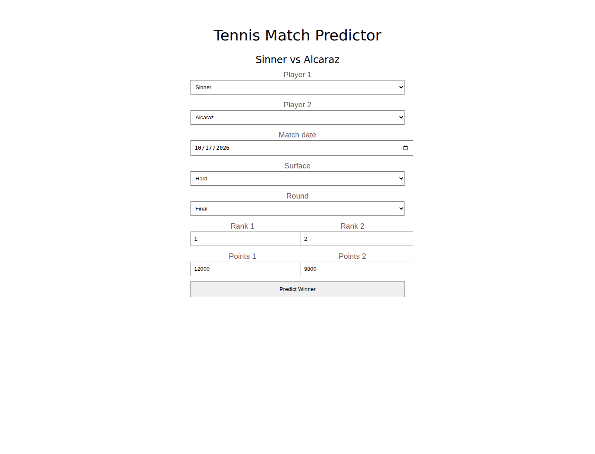
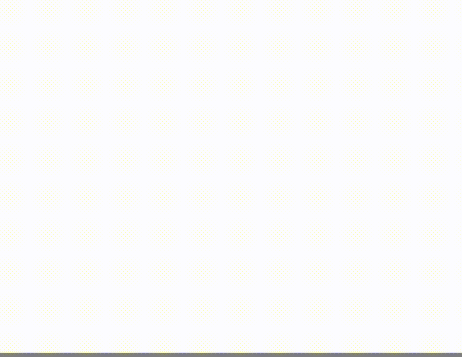
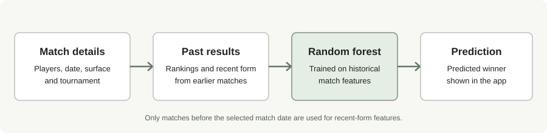

# Tennis Predictor

I built this project to see if I could use past ATP match results to predict the winner of a future match. It has a React frontend, a Flask backend, and a random forest model that looks at rankings and recent player form.

You can choose two players, enter the match details, and get a prediction. The main thing I focused on was making sure the model only uses information that would have been available before the match date. Otherwise, the results can look better than they would in real use.

## Demo



Here is a quick run through of making a prediction:



The screenshots are captured from the app in GitHub Actions.

## How a prediction works



The model uses 19 features, including:

- The difference in player rankings and ranking points
- Court surface and tournament round
- Each player's win rate over their last 5 and 10 matches
- Recent results on the selected surface
- Past head-to-head results between the players

The recent-form and head-to-head features only use matches from earlier calendar dates. Since the dataset doesn't include match start times, matches on the same date aren't used to build one another's features. This helps avoid accidentally giving the model information from the match it's trying to predict.

## Tech I used

- Python, pandas, and scikit-learn
- Flask for the prediction API
- React and Vite for the frontend
- GitHub Actions for tests and frontend build checks

## Run it locally

You'll need Python 3, Node.js/npm, and the ATP match dataset. From the repository root, run:

```bash
chmod +x run.sh
./run.sh
```

The script sets up a local Python environment, installs the dependencies when needed, starts the backend and frontend, and prints the local addresses. Open `http://localhost:5173` for the website. The API runs at `http://127.0.0.1:5000`.

If you want to start each part yourself, open two terminals.

Backend:

```bash
python3 -m pip install -r requirements.txt
python3 backend/app.py
```

Frontend:

```bash
cd frontend
npm ci
npm run dev
```

If the dataset is stored somewhere else, set `DATA_PATH` before starting the backend:

```bash
DATA_PATH=/absolute/path/to/atp_tennis.csv python3 backend/app.py
```

The repository also includes a tiny sample CSV for checking that setup works. It isn't large enough to use for meaningful model evaluation, so use the main ATP dataset when measuring performance.

## Check how well it performs

From the repository root, run:

```bash
python -m backend.evaluate_model
```

If you used `./run.sh`, you can use `.venv/bin/python -m backend.evaluate_model` instead.

The evaluation trains on matches before January 1, 2024 and tests on matches from that date onward. It reports accuracy, precision, recall, F1, a confusion matrix, and a classification report. It also compares the model with a simple baseline that picks the player with the better ranking.

I wouldn't judge the model by accuracy alone. The size and date range of the dataset matter, and a model should be compared with a reasonable baseline. The held-out test period should also stay separate from any hyperparameter tuning.

To run the tests:

```bash
python -m unittest discover -s tests -v
```

If you used the project launcher, run `.venv/bin/python -m unittest discover -s tests -v`.

## Where to look in the code

- `backend/app.py` handles API requests and input validation.
- `backend/prepare_data.py` prepares the data and builds the match features.
- `backend/model.py` configures and trains the random forest.
- `backend/evaluate_model.py` evaluates the model against a held-out period and ranking baseline.
- `backend/model_tuner.py` runs an optional hyperparameter search on the training period.
- `frontend/src/App.jsx` contains the main interface.
- `tests/` contains regression tests for the data, API, and evaluation code.

For a longer explanation, see [the code walkthrough](docs/CODE_WALKTHROUGH.md).

## Limitations

This project is a learning and portfolio project, not a betting tool. It predicts a winner label rather than a calibrated probability. It doesn't account for things like injuries, fatigue, travel, weather, or withdrawals, and its results depend on the data available. The model can be wrong, and its performance on past matches doesn't guarantee how it will do on future ones.
